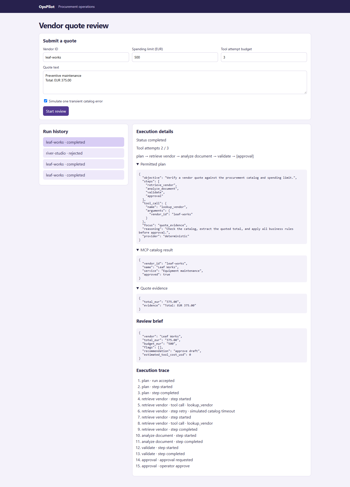

# OpsPilot

OpsPilot reviews vendor quotes against a procurement catalog and a spending limit. A planning step defines the workflow, an MCP client reads the catalog, a document step extracts the quoted total, and a validator prepares a brief. An operator approves or rejects the brief.



## Run locally

Use Python 3.12.

```sh
python -m venv .venv
.venv/bin/python -m pip install -r requirements-dev.txt
DEMO_MODE=true .venv/bin/python -m uvicorn opspilot.app:from_env --factory --host 127.0.0.1
```

On PowerShell, use `.venv/Scripts/python.exe` and set `$env:DEMO_MODE = 'true'` before starting Uvicorn. Open [http://127.0.0.1:8000](http://127.0.0.1:8000). Submit the sample quote with the transient failure checkbox selected. Wait for the backoff and catalog retry, inspect the output and approve the brief.

For Docker, build with `docker build -t opspilot .` and run with `docker run --rm -p 127.0.0.1:8000:8000 -e DEMO_MODE=true -v opspilot-data:/app/data opspilot`.

## Workflow and API

| Method | Path | Result |
| --- | --- | --- |
| POST | `/api/runs` | Submits a quote. An optional `Idempotency-Key` prevents duplicate jobs. |
| GET | `/api/runs` | Lists the latest 100 runs. |
| GET | `/api/runs/{id}` | Reads a run's current stage, outputs and trace. |
| POST | `/api/runs/{id}/decision` | Takes `{"decision":"approve"}`, `reject` or `cancel`. |
| POST | `/api/worker/tick` | Processes one ready stage. |

All run operations require `Authorization: Bearer <operator-token>`. The demo uses an embedded sample token. For deployment, disable demo mode, set a random `OPERATOR_TOKEN` with at least 32 characters and set `DATABASE_PATH` to a persistent location.

SQLite stores the state machine, retry deadlines, lease tokens and trace. Each step checkpoints before the next can start. A worker can reclaim an expired lease, while the old worker's token cannot save a stale result. Catalog attempts are reserved durably before transport starts and count towards the per-run budget. The SDK launches a project-owned MCP STDIO process, negotiates a session and can invoke only the validated `lookup_vendor` operation.

The application defaults to deterministic planning and analysis for this procurement template. The catalog contains synthetic vendors and the quote must contain one `Total: EUR 375.00` style line. The approval records an internal operator decision and makes zero purchase or payment calls. This application uses one operator role and one local database. The dashboard exposes the plan, exact structured MCP result, quote evidence and derived review brief.

## Optional model planner

Set `PLANNER_PROVIDER=openai`, `PLANNER_API_KEY`, `PLANNER_MODEL` and optionally `PLANNER_ENDPOINT` to use an authorized HTTPS Chat Completions provider. This sends the submitted vendor ID, quote and spending limit to the configured endpoint. The default `rules` provider makes no model calls, even if a key is present.

The model proposes a review focus, short rationale and structured catalog invocation. Validation requires the four existing stages in their fixed order, the single `lookup_vendor` tool, and the exact submitted vendor ID. Extra arguments, other tools, changed vendors and omitted approvals are rejected. The validated tool result propagates into deterministic decimal and vendor checks; model narrative cannot bypass them. Existing saved deterministic plans remain executable.

Plans record their provider, model, latency and available token counts. Local tool cost remains separate from optional model usage. Provider calls have a ten-second total deadline, bounded output, at most three automatic attempts and persisted `Retry-After` delays. Errors use stable codes without response contents or credentials. The provider protocol and hostile-plan cases are tested with injected responses; live paid inference requires authorized credentials and budget and has not been verified here.

## Verify

```sh
python -m pytest -q
ruff check opspilot tests
python -m pip_audit
```

With a running local demo, `python tests/smoke_app.py --url http://127.0.0.1:8000` verifies actual MCP lookup, transient retry, business flags, approval and rejection. CI runs this check inside the built container. Use vendor `river-studio` with a spending limit below the quote to inspect an escalation recommendation, then reject the internal brief.

The tests run the actual SDK client and catalog subprocess in the main workflow, simulate a temporary failure and a restart, and verify the approval gate and contention between workers. Planner tests pass a mocked model's validated tool call into the real MCP client, reject hostile plans, and verify rate-limit persistence. The offline demonstration incurs no model expense. [MCP Python SDK](https://github.com/modelcontextprotocol/python-sdk).

## License

Original project code is licensed under MIT. See [LICENSE](LICENSE) and [third-party notices](THIRD_PARTY_NOTICES.md).
